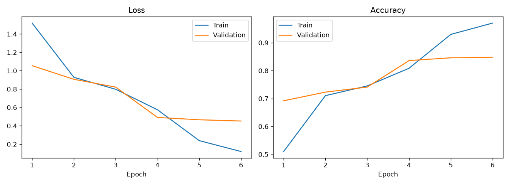
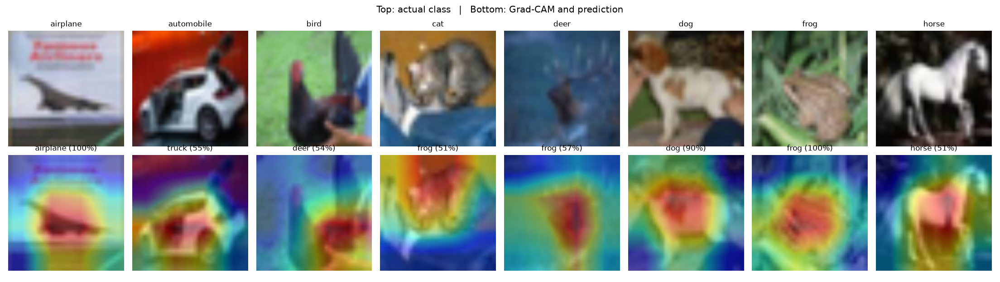

# CIFAR-10 Image Classification — Week 06

An image-classification project on the CIFAR-10 dataset (60,000 colour images, 32x32 pixels, 10 classes). The same task is solved in two ways so the approaches can be compared:

1. **CNN from scratch** — a small convolutional network trained from random weights.
2. **Transfer learning** — a ResNet-18 pretrained on ImageNet, first used as a feature extractor and then fine-tuned.

Grad-CAM is then used to show which part of each image the fine-tuned model looked at.

## Models trained

| Name | Model | Training images | Image size |
|---|---|---:|---|
| `scratch_cnn_full` | CNN from scratch | 45,000 | 32x32 |
| `scratch_cnn_subset` | The same CNN from scratch | 5,000 | 32x32 |
| `resnet18_finetuned` | Pretrained ResNet-18 | 5,000 (the same ones) | enlarged to 112x112 |

The pretrained model is trained on a 5,000-image subset so that it finishes in minutes on a CPU. The from-scratch CNN is also trained on that same subset, which gives a fair "same data" comparison.

## Data split

| Split | Images | Used for |
|---|---:|---|
| Train | 45,000 | Updating the weights. |
| Validation | 5,000 | Watching progress after every epoch. |
| Test | 10,000 | Final results only, in `evaluate.py`. |

The train/validation split is made from CIFAR-10's 50,000 training images with a fixed seed, so it is the same on every run.

## Setup (PowerShell)

Run these commands from the project root (`Week 06/CIFAR10_Image_Classification`):

```powershell
python -m venv .venv
.\.venv\Scripts\Activate.ps1
python -m pip install --upgrade pip
python -m pip install -r requirements.txt
```

If PowerShell blocks virtual-environment activation, use the environment's Python directly:

```powershell
.\.venv\Scripts\python.exe -m pip install -r requirements.txt
```

## Run order

From the project root:

```powershell
python src/download_data.py
python src/train_scratch.py
python src/train_transfer.py
python src/evaluate.py
python src/grad_cam.py
```

| Step | Script | What it does | Creates |
|---|---|---|---|
| 1 | `download_data.py` | Downloads CIFAR-10 (about 170 MB) and prints the class counts. | `data/cifar-10-batches-py/` |
| 2 | `train_scratch.py` | Trains the from-scratch CNN on the full training split, then again on the 5,000-image subset. | `models/scratch_cnn_full.pth`, `models/scratch_cnn_subset.pth`, training curves |
| 3 | `train_transfer.py` | Trains the pretrained ResNet-18 in two stages. Downloads the ImageNet weights (about 45 MB) the first time. | `models/resnet18_finetuned.pth`, training curves |
| 4 | `evaluate.py` | Tests all three models on the 10,000 test images. | `outputs/metrics.json`, confusion matrices |
| 5 | `grad_cam.py` | Draws Grad-CAM heatmaps for the fine-tuned ResNet-18. | `outputs/grad_cam.png` |

Steps 2 and 3 are independent of each other, but both must finish before steps 4 and 5. Everything runs on CPU.

## Project structure

```text
CIFAR10_Image_Classification/
├── data/                  # Downloaded dataset (not committed)
├── models/                # Trained weights (not committed)
├── outputs/               # Metrics, plots and Grad-CAM image
├── src/
│   ├── config.py          # Paths and hyperparameters
│   ├── download_data.py   # Downloads the dataset
│   ├── data.py            # Transforms, train/validation split, data loaders
│   ├── models.py          # From-scratch CNN and pretrained ResNet-18
│   ├── engine.py          # Training loop, evaluation loop, curve plots
│   ├── train_scratch.py   # Trains the from-scratch CNN (full and subset)
│   ├── train_transfer.py  # Feature extraction, then fine-tuning
│   ├── evaluate.py        # Test-set comparison of all models
│   └── grad_cam.py        # Grad-CAM heatmaps
├── requirements.txt
└── README.md
```

## Results

Measured on the 10,000 CIFAR-10 test images:

| Model | Training images | Accuracy | Precision | Recall | F1 (macro) |
|---|---:|---:|---:|---:|---:|
| `scratch_cnn_full` | 45,000 | 75.30% | 75.85% | 75.30% | 75.09% |
| `scratch_cnn_subset` | 5,000 | 60.37% | 64.86% | 60.37% | 61.25% |
| `resnet18_finetuned` | 5,000 | **84.12%** | 84.38% | 84.12% | 84.10% |

- **Data matters:** the same CNN drops from 75.3% to 60.4% with 9 times fewer training images.
- **Pretraining matters more:** with the same 5,000 images, the pretrained ResNet-18 scores 84.1%, beating even the from-scratch CNN trained on all 45,000.
- **Training curves:** the from-scratch CNN was still improving after 8 epochs. The ResNet-18 jumped from 74% to 84% validation accuracy when fine-tuning began, then started to overfit (97% training vs 85% validation accuracy).

### Per-class accuracy

| Class | Scratch, full | Scratch, subset | ResNet-18 |
|---|---:|---:|---:|
| airplane | 86.7% | 65.5% | 87.2% |
| automobile | 90.2% | 71.7% | 89.7% |
| bird | 67.3% | 62.0% | 71.4% |
| cat | 51.6% | 61.9% | 74.2% |
| deer | 66.5% | 39.2% | 86.0% |
| dog | 62.5% | 42.7% | 77.4% |
| frog | 83.5% | 64.9% | 90.7% |
| horse | 85.6% | 69.0% | 84.9% |
| ship | 82.4% | 65.0% | 90.0% |
| truck | 76.7% | 61.8% | 89.7% |

Vehicles are easier than animals. The ResNet-18's most common mistakes are dog → cat (139 images) and cat → dog (102).





In the Grad-CAM sample (the first test image of 8 classes), airplane, dog, frog and horse are correct, with the heatmap on the object; the 4 mistakes all have confidence close to 50%.

## Outputs

- `outputs/metrics.json` — accuracy, precision, recall, F1 and per-class accuracy for each model.
- `outputs/confusion_matrix_*.png` — confusion matrix for each model.
- `outputs/training_curves_*.png` and `outputs/history_*.json` — loss and accuracy per epoch.
- `outputs/grad_cam.png` — Grad-CAM heatmaps.

## Notes

- All hyperparameters (epochs, learning rates, subset size, image size) are in `src/config.py`.
- Results change a little between runs and between machines.
- The pretrained ResNet-18 sees only 5,000 training images at 112x112. Training it on all 45,000 images at 224x224 would score higher but is too slow for a CPU.
